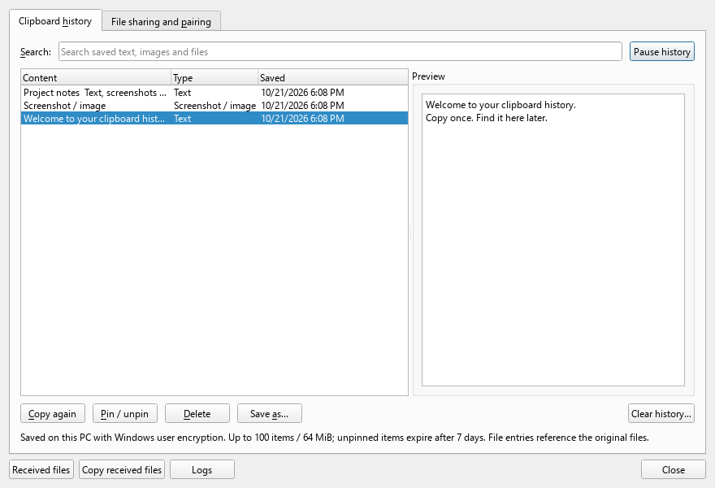
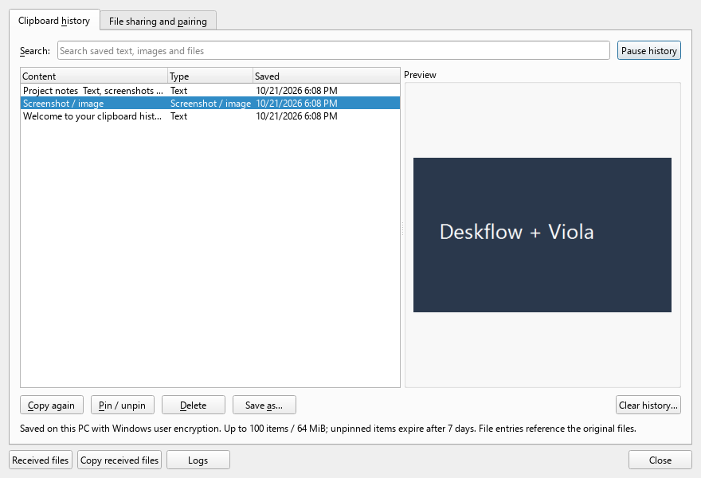
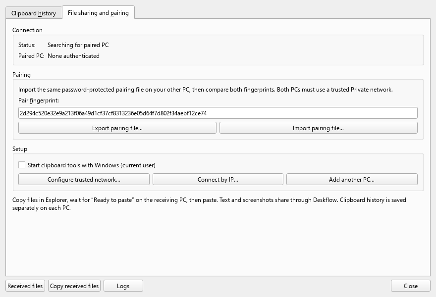

<div align="center">

<picture>
  <source media="(prefers-color-scheme: dark)" srcset="https://github.com/deskflow/deskflow-artwork/blob/main/logo/deskflow-logo-dark-200px.png?raw=true">
  <source media="(prefers-color-scheme: light)" srcset="https://github.com/deskflow/deskflow-artwork/blob/main/logo/deskflow-logo-light-200px.png?raw=true">
  
</picture>

# Deskflow + Viola

**One keyboard. One mouse. A clipboard that goes further.**

Share control across your computers, copy files between them,
and find saved text and screenshots in a familiar Deskflow interface.

[](https://github.com/mtrakretech/deskflow/actions/workflows/viola-windows.yml?query=branch%3Aviola%2Fclipboard-and-easy-setup)
[](../src/apps/viola-bridge/README.md)
[](https://github.com/mtrakretech/deskflow/tree/viola/clipboard-and-easy-setup)

[Windows builds](https://github.com/mtrakretech/deskflow/actions/workflows/viola-windows.yml?query=branch%3Aviola%2Fclipboard-and-easy-setup) · [Setup guide](../src/apps/viola-bridge/README.md) · [Security](../src/apps/viola-bridge/SECURITY.md) · [Upstream Deskflow](https://github.com/deskflow/deskflow)

</div>

> [!NOTE]
> This is an independent Windows-focused fork. Development is on `viola/clipboard-and-easy-setup` in [pull request #1](https://github.com/mtrakretech/deskflow/pull/1). Packages are available as workflow artifacts; a tagged public release has not been published.

## Your desk, connected

| Feature | What you can do |
| :--- | :--- |
| **Shared keyboard and mouse** | Move between computers using Deskflow's existing screen layout and controls. |
| **Text and screenshots** | Use Deskflow's text, HTML and bitmap clipboard sharing. |
| **Files and folders** | Copy in Explorer, wait for **Ready to paste** on the other PC, then paste. Transfers stream over authenticated TLS and verify each file with SHA-256. |
| **Saved clipboard history** | Search, preview, copy again, pin, delete, clear, or save text and screenshots. File entries reference the original files. |
| **Familiar interface** | Open history and pairing from Deskflow's **Clipboard** menu or tray. The integrated dialogs use Deskflow's Qt theme, fonts and native controls. |
| **Easier setup** | Use one installer on each PC, or create a private **Add another PC** bundle with a password-protected pairing file. |

History is encrypted for the current Windows user and saved **on each PC separately**. Deskflow handles live text/image sharing; Viola handles file transfer and local history.

## Feels like Deskflow

The clipboard tools use the same Qt interface as Deskflow: familiar tabs, native controls, and the application's theme and fonts.



<details>
<summary><strong>Screenshot previews and pairing settings</strong></summary>





</details>

Screenshots use isolated sample data from the native UI test. Your history and pairing data stay on your PC.

## Start on two PCs

1. Open a successful **Deskflow + Viola Windows** [workflow run](https://github.com/mtrakretech/deskflow/actions/workflows/viola-windows.yml?query=branch%3Aviola%2Fclipboard-and-easy-setup). Download **Deskflow-Viola-0.3.0-Windows-x64** from its artifacts and extract it.
2. Run **Deskflow-Viola-0.3.0-Setup.exe** on each PC. Configure the keyboard/mouse server, client and screen arrangement in Deskflow as usual.
3. Open **Clipboard → File sharing and pairing**. Export a password-protected pairing file from one PC and import it on the other. Compare the full fingerprints, then delete the exported file.
4. Use **Configure trusted network…** on both PCs to select your trusted LAN and apply the app-specific Private firewall rules. Windows may request administrator approval for this step.
5. When the status reads **Connected**, copy a small file in Explorer. Wait for **Ready to paste** on the receiving PC, then press **Ctrl+V** in its destination folder.

**Already using Deskflow?** The smaller **Viola-0.3.0-companion-Windows** artifact adds the companion beside an existing installation. Install the full fork package for the integrated Qt interface. Existing Viola 0.2.0 pairing is preserved during an ordinary upgrade.

**Adding another computer?** Use **Add another PC…** to create a private setup ZIP. Transfer it using a trusted method, extract it on the new PC and run the included setup. Send its password separately. Keep private bundles and pairing files out of public repositories.

## Find it again

Open **Clipboard → Clipboard history** in Deskflow.

- Search saved text, screenshots and file references.
- Select an item to preview it; choose **Copy again**, then paste in your app.
- Pin useful items, save a text or PNG copy, or pause history capture.
- Clear history when you are finished with it.

The local store is bounded to **100 items / 64 MiB**. Unpinned items expire after **7 days**; pins still count toward the overall limits. Clipboard history exclusion markers are respected.

## Built to stay out of your way

- Fixed buffers and 64-bit lengths support file transfers larger than 4 GiB.
- Background file transfers preserve newer text, images or files you copied meanwhile.
- Cross-computer **Cut** is treated as **Copy**, keeping source files safe.
- Pairing credentials and history use Windows user encryption. File peers authenticate through a pinned certificate.
- File sharing uses a trusted **Private**, same-subnet IPv4 Ethernet/Wi-Fi LAN, with app-specific local-subnet firewall rules.

Current limits: **one active file peer**, full-transfer retry after interruption, and Windows-only Viola additions. Paste files after the receiving notification. macOS/Linux retain upstream Deskflow functionality. See the [feature guide](../src/apps/viola-bridge/README.md) for details.

## Build and verify

The [Windows workflow](workflows/viola-windows.yml) compiles the C++/Qt application, tests the companion, checks the native clipboard UI against isolated fixture data, and packages a complete installer and portable build. UI screenshots are uploaded separately.

For a local companion build on Windows:

```powershell
./src/apps/viola-bridge/Build.ps1 -Tests -NoClipboard
```

Add `-Large` for the transfer test above 4 GiB. Interactive clipboard tests require an isolated desktop session. For the complete toolchain, follow the [Deskflow build guide](https://github.com/deskflow/deskflow/wiki/Building) and enable `BUILD_VIOLA_BRIDGE` on Windows. Enable `BUILD_VIOLA_UI_SMOKE` to build the native dialog test.

Physical desktop/laptop file copy-paste was confirmed with the earlier bridge. New builds still need acceptance checks on each target PC, including reboot and sleep/wake behavior.

## Thanks to Deskflow

Built on [Deskflow](https://github.com/deskflow/deskflow), its contributors and the wider Synergy/Input Leap/Barrier history. The original README, community links and platform information are preserved in [UPSTREAM.md](UPSTREAM.md).

Deskflow and its Qt integration retain **GPL-2.0 with the existing OpenSSL exception**. The independent Viola companion is **MIT**. See [license texts](../LICENSES), the [companion license](../src/apps/viola-bridge/LICENSE), and per-file SPDX notices.
